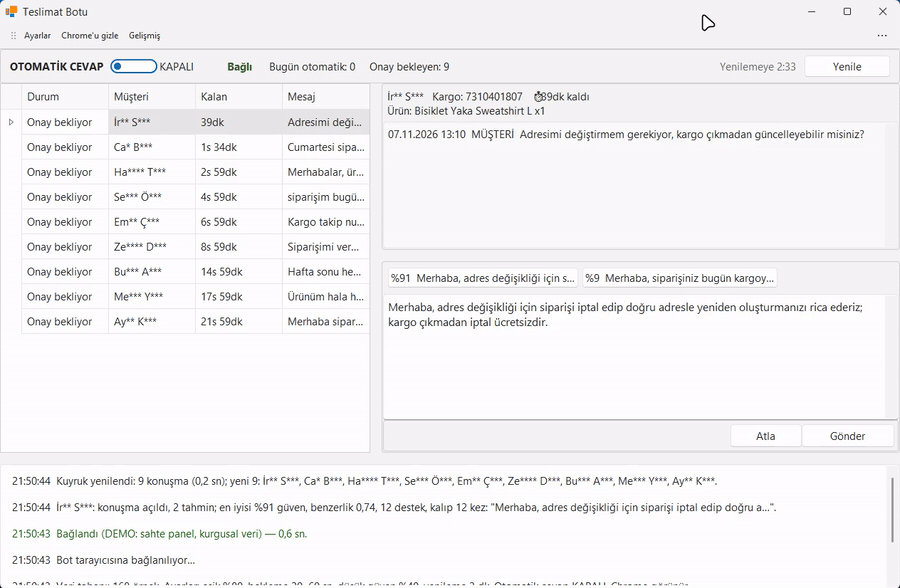
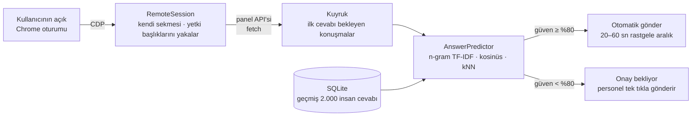
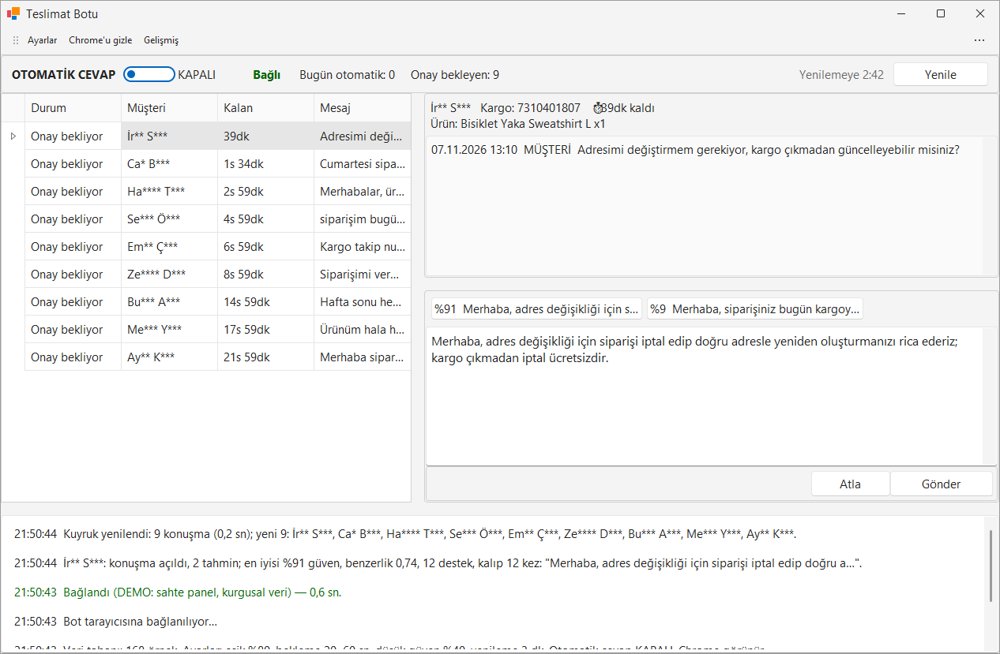
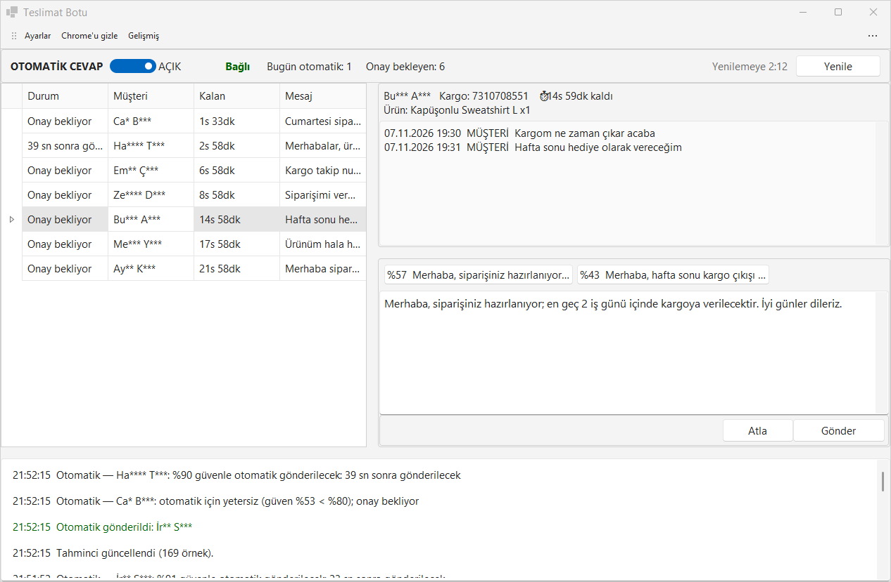
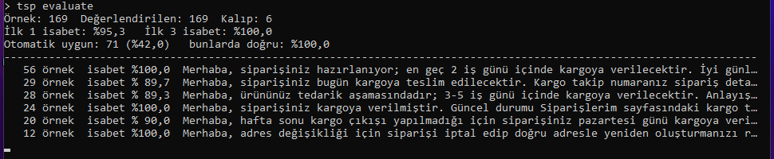
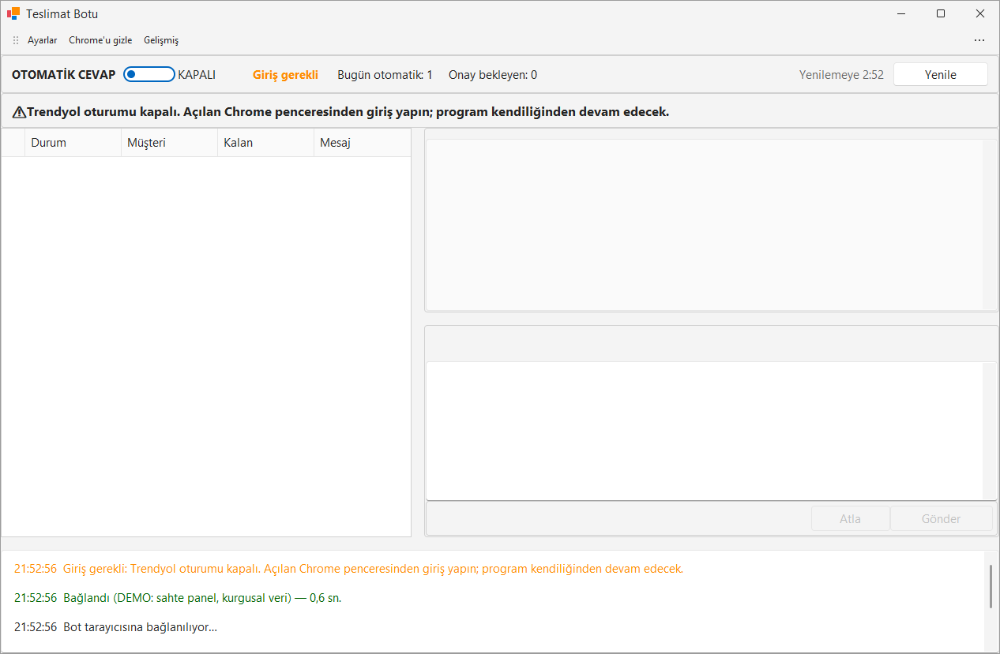

# Teslimat Botu — Trendyol Sipariş Sorularına Öğrenen Otomatik Cevap

**Trendyol satıcı panelindeki "Teslimat Durumu" sorularını, mağazanın geçmiş 2.000 cevabından öğrenerek yanıtlayan; yüksek güvenli tahminleri kendiliğinden gönderen, gerisini personel onayına bırakan masaüstü botu.**

-lightgrey)

> **30 saniyede:**
> - **Problem:** Müşteri hizmetleri her gün onlarca "Kargom nerede?" sorusuna, yıllardır kullanılan ~10 kalıptan uygun olanı seçip elle yazıyordu.
> - **Çözüm:** Yerel çalışan, dış servise veri göndermeyen bir **benzerlik modeli** (karakter n-gram TF-IDF + kosinüs benzerliği + k en yakın komşu) geçmiş cevaplardan doğru kalıbı tahmin eder. Güven ≥ %80 ise otomatik gönderir, değilse "Onay bekliyor" kuyruğuna alır.
> - **Ölçülen sonuç:** 2.000 gerçek konuşma üzerinde **%93,3 ilk-1 isabet**; otomatik gönderime uygun bulunan sorularda **%98,2 doğruluk**, soruların **%87,5**'i otomatik cevaplanabilir.

  

<b>English summary</b>

A desktop bot that answers "Where is my order?" questions in the Trendyol seller panel. It learns from the store's last 2,000 human replies using a fully local model (character n-gram TF-IDF, cosine similarity, k-nearest-neighbour voting over reply templates). Predictions with confidence ≥ 80% are sent automatically with randomized 20–60 s pacing; the rest wait for staff approval. Offline evaluation on 2,000 real conversations: 93.3% top-1 accuracy, 98.2% precision on auto-eligible questions covering 87.5% of traffic. Browser automation via Playwright over Chrome DevTools Protocol, reusing the operator's logged-in session. 112 MSTest tests. Source is private.

---

## Problem

Trendyol'da sipariş sorularının büyük kısmı aynı konudadır: teslimat. Mağaza bu sorulara yıllardır yaklaşık 10 sabit kalıpla cevap veriyordu; ancak **hangi kalıbın** seçileceği müşterinin ne yazdığına bağlıydı ("hâlâ gelmedi", "kargoya verildi mi", "adresimi değiştirebilir miyim" …). Bu seçim her gün tekrar eden, dikkat isteyen ama katma değeri düşük bir işti. Cevap süresinin (~72 saat) aşılması ise mağaza puanını etkiliyordu.

Kısıtlar da netti:
- Müşteri verisi **makineden çıkmamalı** → harici yapay zekâ servisi kullanılamaz.
- Panelde bot **hiçbir şeye tıklamamalı**; hesabın güvenliği riske atılmamalı.
- Bilgisayar bilmeyen biri kurup kullanabilmeli.

## Çözüm

1. **Geçmişi içe aktar:** Gönderilmiş kutusundan en yeni ~2.000 Teslimat Durumu konuşması, istekler arası ~3 sn beklemeyle çekilir ve SQLite'a yazılır.
2. **Kalıpları keşfet:** `TemplateGrouper`, satıcı cevaplarını normalize edip ~10 kalıba gruplar.
3. **Tahmin et:** Yeni soru normalize edilir, karakter n-gram TF-IDF vektörü çıkarılır, en benzer 15 geçmiş soru bulunur; komşuların oy dağılımı **güven**, en yakın örneğin benzerliği **benzerlik** skoru olur.
4. **Karar ver:** Eşik üstü otomatik, eşik altı personel onayına.

## Mühendislik kararları

- **Model kendi tahminini öğrenmesin.** Otomatik gönderilen cevaplar `OTOMATIK` kaynağıyla kaydedilir ve eğitim havuzuna **alınmaz** — geri besleme döngüsüyle modelin kendini pekiştirmesi engellenir.
- **Ölçülebilir başarı.** `Evaluator`, geçmiş veride "bir-dışarıda-bırak" yöntemiyle ilk-1 isabeti, otomatik uygunluk oranını ve otomatik doğruluğu raporlar; eşik bu ölçümlere göre ayarlanabilir.
- **Yazım hatalarına dayanıklılık.** Kelime içi 3–5 karakterlik n-gram'lar ve Türkçe metin normalizasyonu sayesinde "kargom gelmedı", "kargom gelmedi" ve "kargomm gelmedi" aynı kalıba yakın düşer.
- **Basit ve açıklanabilir model.** Derin öğrenme yerine TF-IDF + kNN: eğitim saniyeler sürer, bağımlılık yok, her tahminin hangi geçmiş örneklere dayandığı gösterilebilir.
- **Tarayıcıyı kullanıcının oturumuyla paylaşmak.** Bot ayrı bir Chrome profili başlatır ya da açık olanın DevTools portuna bağlanır, yalnızca **kendi sekmesini** açar; yetki başlıklarını panelin kendi isteklerinden yakalar. Başka Chrome süreçlerine dokunmaz, port yalnız `127.0.0.1`'de dinler.
- **Oturum düşerse kibarca bekle.** Giriş sayfasına yönlendirme tespit edilir (`LoginDetector`), kullanıcıya büyük bir uyarı gösterilir ve giriş yapılınca bot kendiliğinden devam eder.
- **İnsan gibi davran.** Otomatik gönderimler arasında rastgele 20–60 sn; ilk aktarımda istekler arası bekleme; tekrar deneme politikası (`PanelRetry`).
- **Spec → plan → test.** Her özellik önce tasarım dokümanı, sonra adım adım plan, ardından testle (RED→GREEN) geliştirildi.

## Kalite ve test

| Metrik | Değer |
|---|---|
| Üretim kodu | ~5.500 satır C# (Core kütüphanesi + WinForms + CLI) |
| Test | **112 MSTest** testi (tahminci, değerlendirici, otomatik cevaplayıcı, gönderim servisi, oturum tespiti, geçmiş aktarımı…) + JSON konuşma fixture'ları |
| Model değerlendirmesi | 2.000 konuşma: ilk-1 %93,3 · otomatik uygun %87,5 · otomatik doğru %98,2 |
| Dağıtım | Tek dosyalık kurulum (`TeslimatBotu-Kurulum.exe`), masaüstü/Başlat menüsü kısayolu, kaldırılabilir |

## Teknoloji yığını

| Alan | Teknolojiler |
|---|---|
| Dil / Runtime | C#, .NET 9 |
| Arayüz | WinForms + DevExpress 26.1 |
| Otomasyon | Microsoft Playwright (Chrome DevTools Protocol üzerinden mevcut Chrome'a bağlanma) |
| NLP / Tahmin | Kendi yazdığım karakter n-gram vektörleştirici, TF-IDF, kosinüs benzerliği, kNN oylama |
| Veri | SQLite (`Microsoft.Data.Sqlite`) |
| Mimari | `Core` (UI bağımsız kütüphane) · `WinForms` arayüz · `CLI` araçları (değerlendirme, aktarım) |
| Test | MSTest |

## Ekran görüntüleri

| | |
|---|---|
|  **Kuyruk** — tahmin ve güven skoru |  **Otomatik mod AÇ/KAPA** |
|  **CLI değerlendirme raporu** |  **Oturum kapalı uyarısı** |

> Görsellerdeki müşteri adları, mesajlar, sipariş/kargo numaraları ve geçmiş cevaplar kurgusaldır. Uygulama, izole bir demo kopyasında ayrı bir veri klasörüyle, Trendyol paneli yerine bellekte sahte veri döndüren bir istemciyle çalıştırılmıştır; hiçbir müşteriye mesaj gitmemiştir. Değerlendirme raporundaki oranlar bu küçük demo veri setine aittir; yukarıdaki %93,3 / %98,2 sonuçları gerçek 2.000 konuşmalık ölçümdür.

## Rolüm

Tek geliştirici: problem analizi, panel API'sinin incelenmesi, tahmin modelinin tasarımı ve ölçülmesi, uygulama, test, kurulum paketi.

## Kaynak kodu hakkında

Bu depo bir **vaka çalışmasıdır**; kod ticari bir işletmeye ait olduğu için paylaşılmamaktadır. Görüşmede canlı demo ve kod incelemesi yapabilirim.

**Paylaşılabilen kısım:** [`ornek-kod/`](ornek-kod) klasöründe asıl projeden alınmış, gizli bilgi içermeyen küçük bir parça var: müşteri sorusunu benzer geçmiş sorularla eşleştiren metin normalizasyonu ve karakter n-gram benzerliği. Tek başına derlenir ve birim testleriyle birlikte gelir (`dotnet test`).

📫 **İletişim:** [GitHub profilim](https://github.com/furkan-karapinar)
